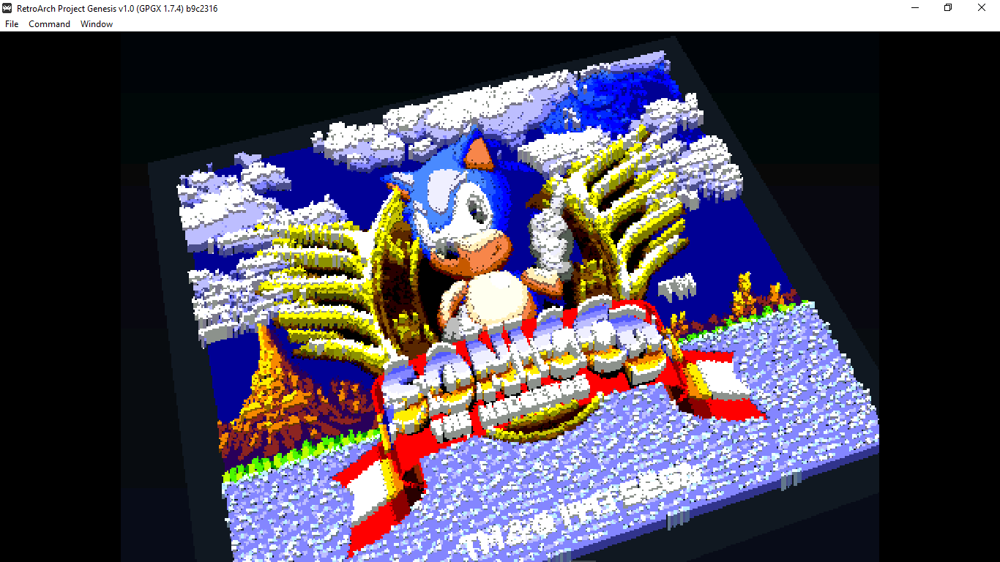
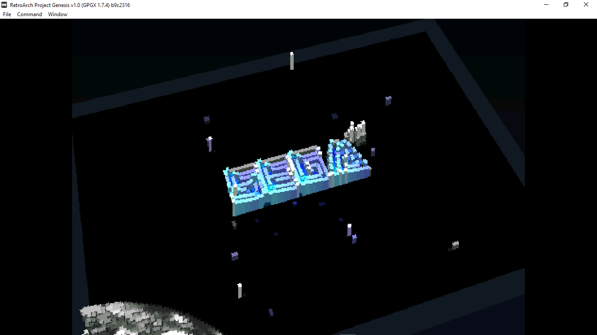
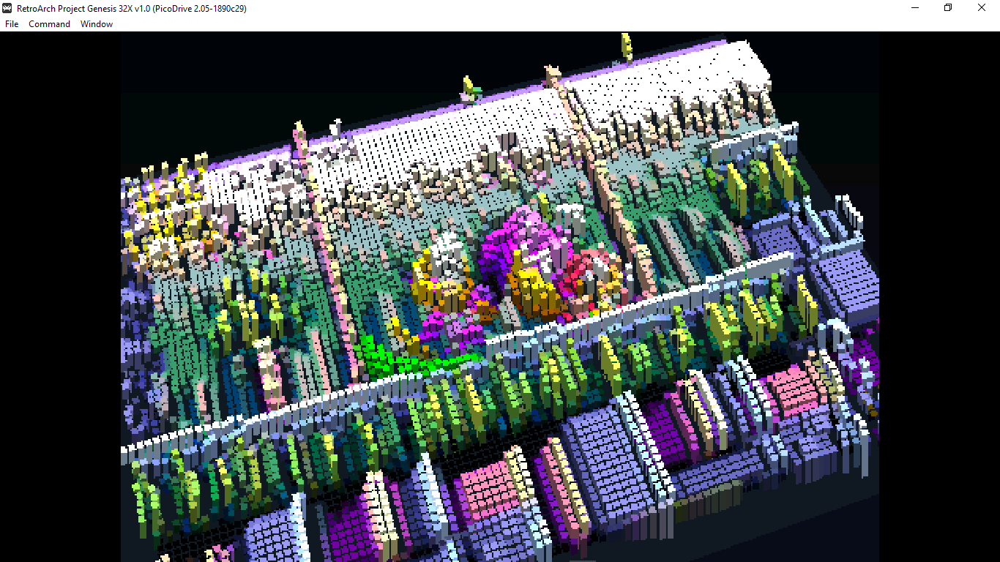
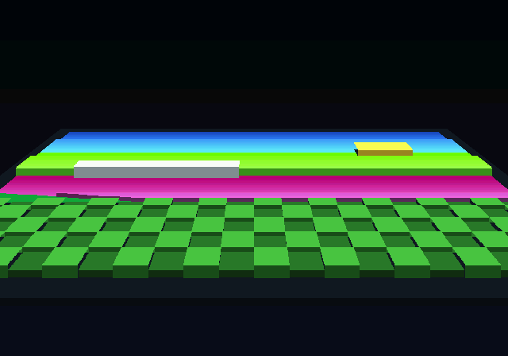
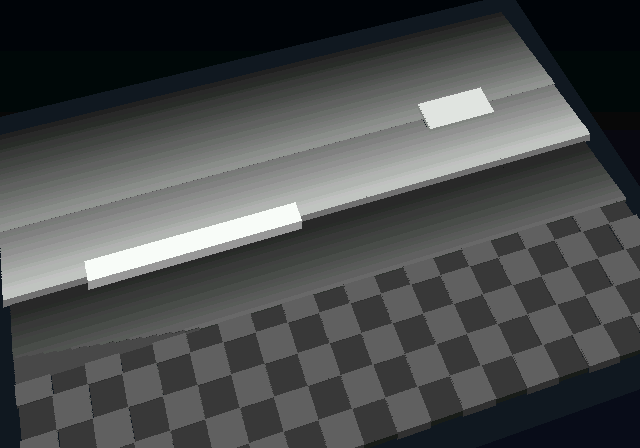
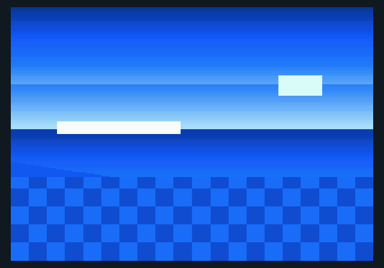

<!--
  ============================================================================
   PROJECT VOXEL  ::  MEGA DRIVE READY THEME
   README reescrito com o tema 16-bit. O conteudo tecnico original
   (tabelas, pipeline, previews, validacao, estrutura e creditos) foi
   preservado integralmente -- so a apresentacao mudou.
   Tema: assets/ (banner, press start, divider, select screen, wordmark)
   ============================================================================
-->

<div align="center">
  
</div>

<br>

<div align="center">


</div>

<br>

<!-- ============================== ESTILO ============================== -->
<style>
/* ==========================================================================
   PROJECT VOXEL :: MEGA DRIVE READY THEME
   O GitHub sanitiza o CSS de estilo dentro do README: aqui ficam apenas
   propriedades seguras (cor, borda, fonte, sombra, largura). A animacao
   de verdade mora nos SVGs de assets/ (SMIL/CSS interno), que rodam
   em 100% dos casos porque sao imagens independentes.
   ========================================================================== */

.markdown-body {
  background-color: #0a0418;
  color: #d9d2f5;
  font-family: 'Press Start 2P', 'VT323', 'Courier New', monospace;
  font-size: 12px;
  line-height: 1.95;
}

.markdown-body h1,
.markdown-body h2,
.markdown-body h3 {
  color: #f7c04a;
  font-family: 'Press Start 2P', 'VT323', 'Courier New', monospace;
  letter-spacing: .16em;
  text-shadow: 0 0 10px rgba(247, 192, 74, .5), 0 0 26px rgba(123, 47, 214, .35);
  border-bottom: 2px solid #f7c04a;
  padding-bottom: 10px;
  margin-bottom: 18px;
}

.markdown-body h3 {
  color: #8fc7ff;
  font-size: 15px;
  border-bottom: 1px solid #3a2470;
  text-shadow: 0 0 10px rgba(143, 199, 255, .45);
}

.markdown-body a { color: #8fc7ff; text-decoration: none; }
.markdown-body a:hover { color: #f7c04a; text-decoration: underline; }
.markdown-body strong { color: #fff4cd; }
.markdown-body em { color: #e93ce0; font-style: normal; }

.markdown-body blockquote {
  border-left: 4px solid #f7c04a;
  background-color: #150a2e;
  color: #b9b0dd;
  padding: 10px 16px;
}

.markdown-body pre {
  background-color: #0d0522;
  background-image: repeating-linear-gradient(
    0deg, rgba(0, 0, 0, .35) 0px, rgba(0, 0, 0, .35) 1px, transparent 1px, transparent 3px);
  border: 1px solid #f7c04a;
  border-radius: 4px;
  color: #d9f7ff;
}

.markdown-body code { background-color: #1b0d38; color: #ffd94a; border-radius: 3px; }
.markdown-body pre code { background-color: transparent; color: #d9f7ff; }

.markdown-body table { border-collapse: collapse; width: 100%; margin: 14px 0; }
.markdown-body th {
  background-color: #24114a;
  border: 1px solid #f7c04a;
  color: #f7c04a;
  letter-spacing: .1em;
  padding: 10px;
  text-align: left;
}
.markdown-body td { background-color: #120a2c; border: 1px solid #3a2470; padding: 10px; vertical-align: top; }
.markdown-body tr:hover td { background-color: #1a0d3a; }

.markdown-body hr { border: 0; border-top: 2px dashed #f7c04a; opacity: .5; }
.markdown-body img { border-radius: 2px; }
</style>

<!-- ============================== PRESS START ============================== -->
<div align="center">
  
</div>

<div align="center">

| **SITE DO PROJETO** | **INSTALAÇÃO** | **OPÇÕES** | **RETRO8 VOXEL** |
|:---:|:---:|:---:|:---:|
| [▶ PROJECT VOXEL](https://xmyguel-x.github.io/project-voxel/) | [⬇ INSTALAR](docs/INSTALACAO.md) | [⚙ 19 OPÇÕES](docs/OPCOES.md) | [⬛ CÓDIGO-FONTE](https://github.com/xmyguel-x/retro8_voxel) |

</div>

<br>


<!-- ============================== O QUE E ============================== -->
<h2 align="center" style="color:#f7c04a; font-family:'Press Start 2P','VT323','Courier New',monospace; font-size:20px; letter-spacing:.18em; text-shadow:0 0 10px rgba(247,192,74,.55),0 0 26px rgba(123,47,214,.35); border-bottom:2px solid #f7c04a; padding-bottom:10px; margin-bottom:18px;">▸ O QUE É</h2>

Cores **libretro** que reescrevem o quadro 2D de um emulador como uma cena 3D de blocos.
Cada pixel (ou grupo de pixels) do jogo vira um cubo com altura, cor, luz e sombra — o
jogo continua sendo o mesmo, mas passa a ter profundidade, câmera e iluminação.

O nome "Project Voxel" é o guarda-chuva do projeto. São **dois cores**, em **duas
arquiteturas opostas**:

<table style="width:100%;">
<tr>
<th style="width:18%;background:#24114a;border:1px solid #f7c04a;color:#f7c04a;padding:10px;"></th>
<th style="background:#24114a;border:1px solid #f7c04a;color:#f7c04a;padding:10px;">Project Genesis</th>
<th style="background:#24114a;border:1px solid #f7c04a;color:#f7c04a;padding:10px;">Retro8 Voxel</th>
</tr>
<tr>
<td style="background:#150a2e;border:1px solid #3a2470;padding:10px;"><b>O que é</b></td>
<td style="background:#120a2c;border:1px solid #3a2470;padding:10px;">Um core <b>emulado</b>: um emulador Sega com o renderizador voxel compilado dentro</td>
<td style="background:#120a2c;border:1px solid #3a2470;padding:10px;">Um <b>wrapper</b>: um core que carrega outro core em tempo de execução</td>
</tr>
<tr>
<td style="background:#150a2e;border:1px solid #3a2470;padding:10px;"><b>Modos</b></td>
<td style="background:#120a2c;border:1px solid #3a2470;padding:10px;"><b>2</b> — modo <i>GPGX</i> e modo <i>PicoDrive (32X)</i></td>
<td style="background:#120a2c;border:1px solid #3a2470;padding:10px;">1</td>
</tr>
<tr>
<td style="background:#150a2e;border:1px solid #3a2470;padding:10px;"><b>Emula</b></td>
<td style="background:#120a2c;border:1px solid #3a2470;padding:10px;">Sega Mega Drive, Mega-CD, Master System, Game Gear, SG-1000 — <b>+ 32X</b> no modo PicoDrive</td>
<td style="background:#120a2c;border:1px solid #3a2470;padding:10px;">PICO-8 (console fantasy)</td>
</tr>
<tr>
<td style="background:#150a2e;border:1px solid #3a2470;padding:10px;"><b>Como o voxel entra</b></td>
<td style="background:#120a2c;border:1px solid #3a2470;padding:10px;">O patch <b>modifica o código-fonte</b> do emulador e intercepta <code>retro_run</code></td>
<td style="background:#120a2c;border:1px solid #3a2470;padding:10px;">O wrapper <b>intercepta</b> o framebuffer que o core interno entrega</td>
</tr>
<tr>
<td style="background:#150a2e;border:1px solid #3a2470;padding:10px;"><b>Acoplamento</b></td>
<td style="background:#120a2c;border:1px solid #3a2470;padding:10px;">Total — o renderizador é parte do binário</td>
<td style="background:#120a2c;border:1px solid #3a2470;padding:10px;">Nenhum — qualquer core compatível serve</td>
</tr>
<tr>
<td style="background:#150a2e;border:1px solid #3a2470;padding:10px;"><b>Precisa do core original</b></td>
<td style="background:#120a2c;border:1px solid #3a2470;padding:10px;">Não</td>
<td style="background:#120a2c;border:1px solid #3a2470;padding:10px;"><b>Sim</b> — <code>retro8_libretro.so</code> na mesma pasta</td>
</tr>
<tr>
<td style="background:#150a2e;border:1px solid #3a2470;padding:10px;"><b>Tamanho</b></td>
<td style="background:#120a2c;border:1px solid #3a2470;padding:10px;">~1 MB (GPGX) · ~2,3 MB (PicoDrive)</td>
<td style="background:#120a2c;border:1px solid #3a2470;padding:10px;">~56 KB (wrapper + renderizador)</td>
</tr>
<tr>
<td style="background:#150a2e;border:1px solid #3a2470;padding:10px;"><b>Cenário</b></td>
<td style="background:#120a2c;border:1px solid #3a2470;padding:10px;">Cena 3D com blocos, chão e fundo</td>
<td style="background:#120a2c;border:1px solid #3a2470;padding:10px;">Cena 3D com <b>carcaça de videogame</b>, botões afundam ao apertar</td>
</tr>
<tr>
<td style="background:#150a2e;border:1px solid #3a2470;padding:10px;"><b>Formato de origem</b></td>
<td style="background:#120a2c;border:1px solid #3a2470;padding:10px;">RGB565 <b>ou</b> XRGB1555 (GPGX) · RGB565 (PicoDrive)</td>
<td style="background:#120a2c;border:1px solid #3a2470;padding:10px;">XRGB8888, com suporte a RGB565 e 0RGB1555</td>
</tr>
<tr>
<td style="background:#150a2e;border:1px solid #3a2470;padding:10px;"><b>Renderização</b></td>
<td style="background:#120a2c;border:1px solid #3a2470;padding:10px;">Painter's algorithm, sem z-buffer</td>
<td style="background:#120a2c;border:1px solid #3a2470;padding:10px;"><b>z-buffer</b> com rasterização de triângulos</td>
</tr>
<tr>
<td style="background:#150a2e;border:1px solid #3a2470;padding:10px;"><b>Código-fonte</b></td>
<td style="background:#120a2c;border:1px solid #3a2470;padding:10px;">Patch do modo PicoDrive neste repositório; o do GPGX não está publicado</td>
<td style="background:#120a2c;border:1px solid #3a2470;padding:10px;">Publicado em <a href="https://github.com/xmyguel-x/retro8_voxel">retro8_voxel</a></td>
</tr>
</table>

> **Os 2 modos do Project Genesis.** É **o mesmo core** com duas bases de emulação:
> o modo *GPGX* (Genesis Plus GX) e o modo *PicoDrive (32X)*, que acrescenta o 32X.
> Ambos compartilham o mesmo renderizador, as mesmas 19 opções `project_genesis_*` e a
> mesma categoria *"Project Genesis (Voxel 3D)"*. Detalhes em
> [docs/PROJECT-GENESIS.md](docs/PROJECT-GENESIS.md).

---

<!-- ============================== POR QUE ============================== -->
<h2 align="center" style="color:#f7c04a; font-family:'Press Start 2P','VT323','Courier New',monospace; font-size:20px; letter-spacing:.18em; text-shadow:0 0 10px rgba(247,192,74,.55),0 0 26px rgba(123,47,214,.35); border-bottom:2px solid #f7c04a; padding-bottom:10px; margin-bottom:18px;">▸ POR QUE EXISTEM ESSES CAMINHOS?</h2>

O renderizador voxel é, no fundo, um **pós-processador de framebuffer**: ele recebe a
imagem 2D que o emulador desenhou e devolve uma imagem 3D. Isso pode ser feito de duas
formas, e o projeto implementa as duas de propósito:

1. **Patch nativo** — você modifica o emulador, compila o renderizador junto com ele e
   intercepta o `video_cb`. Ganha acesso direto ao estado interno (geometria, opções,
   framebuffer) e um resultado mais integrado. Exige compilar o core.

2. **Wrapper genérico** — você escreve um `.so` que faz `dlopen()` do core original,
   repassa todas as chamadas da API libretro e troca a chamada `video_cb` por uma
   renderização voxel. Não precisa tocar no emulador, funciona com qualquer core, e
   adiciona recursos que o core original não tem — como a carcaça de console.

O [Retro8 Voxel](docs/RETRO8-VOXEL.md) é o segundo caminho. O
[Project Genesis](docs/PROJECT-GENESIS.md) é o primeiro — e como o PicoDrive já roda
Mega Drive, Mega-CD e 32X na mesma base, ele virou o segundo modo do core.

---

<!-- ============================== PIPELINE ============================== -->
<h2 align="center" style="color:#f7c04a; font-family:'Press Start 2P','VT323','Courier New',monospace; font-size:20px; letter-spacing:.18em; text-shadow:0 0 10px rgba(247,192,74,.55),0 0 26px rgba(123,47,214,.35); border-bottom:2px solid #f7c04a; padding-bottom:10px; margin-bottom:18px;">▸ COMO FUNCIONA O RENDERIZADOR</h2>

Ambos os implementos compartilham o mesmo pipeline de software, sem GPU e sem dependências:

```text
frame 2D do emulador (RGB565)
        │
        ▼
 1. AMOSTRAGEM ── cada bloco de `step`×`step` pixels vira 1 célula
        │          (média de cor, saturação, contraste, paleta)
        ▼
 2. ALTURA ────── cada célula ganha uma altura (0..1) conforme o modo:
        │          relevo (brilho), diorama (degraus), cor→altura, plano (fixa)
        ▼
 3. CÂMERA ────── posição esférica (inclinação + azimute), FOV de 40°,
        │          zoom e suavização (lerp) entre quadros
        ▼
 4. CENA ──────── fundo em gradiente, chão opcional, luz direcional
        │
        ▼
 5. DESENHO ───── painter's algorithm: células de trás para frente.
        │          Cada célula visível desenha o topo + até 4 faces laterais
        ▼
 6. RASTERIZAÇÃO─ cada face é um quadrilátero recortado por half-planes
                   e preenchido em RGB565
        │
        ▼
  quadro 3D final
```

Os detalhes de cada etapa estão em **[docs/RENDERIZADOR-VOXEL.md](docs/RENDERIZADOR-VOXEL.md)**.

<br>


<!-- ============================== PREVIEWS ============================== -->
<h2 align="center" style="color:#f7c04a; font-family:'Press Start 2P','VT323','Courier New',monospace; font-size:20px; letter-spacing:.18em; text-shadow:0 0 10px rgba(247,192,74,.55),0 0 26px rgba(123,47,214,.35); border-bottom:2px solid #f7c04a; padding-bottom:10px; margin-bottom:18px;">▸ PREVIEWS</h2>

<div align="center">
  
</div>

### Em execução no RetroArch

<table style="width:100%;">
<tr>
<td style="background:#120a2c;border:1px solid #3a2470;padding:10px;text-align:center;">Project Genesis modo GPGX — Sonic em voxel 3D<br></td>
<td style="background:#120a2c;border:1px solid #3a2470;padding:10px;text-align:center;">Project Genesis modo GPGX — cena esparsa<br></td>
<td style="background:#120a2c;border:1px solid #3a2470;padding:10px;text-align:center;">Project Genesis 32X — modo PicoDrive<br></td>
</tr>
</table>

A diferença de densidade entre as duas capturas do modo GPGX é a consequência direta da
regra do renderizador: **pixel claro vira bloco alto, pixel escuro vira nada**. Um jogo
com muita área preta (fundo de tela) produz uma cena majoritariamente vazia.

### Do motor, sem o RetroArch

Estas imagens foram geradas **pelo próprio renderizador do patch**, usando o harness em
[`tests/voxel_test.c`](tests/voxel_test.c). A cena de teste é sintética (320×224):
céu em gradiente, sol, colinas, chão xadrez e uma faixa clara.

<table style="width:100%;">
<tr>
<td style="background:#120a2c;border:1px solid #3a2470;padding:10px;text-align:center;">Relevo + isométrica<br></td>
<td style="background:#120a2c;border:1px solid #3a2470;padding:10px;text-align:center;">Diorama + baixa<br></td>
</tr>
<tr>
<td style="background:#120a2c;border:1px solid #3a2470;padding:10px;text-align:center;">Neon + Noir<br></td>
<td style="background:#120a2c;border:1px solid #3a2470;padding:10px;text-align:center;">Cor para altura + frontal<br></td>
</tr>
</table>

Para regenerar: `bash tests/run_previews.sh` (detalhes em
[`previews/README.md`](previews/README.md)).

---

<!-- ============================== VALIDACAO ============================== -->
<h2 align="center" style="color:#f7c04a; font-family:'Press Start 2P','VT323','Courier New',monospace; font-size:20px; letter-spacing:.18em; text-shadow:0 0 10px rgba(247,192,74,.55),0 0 26px rgba(123,47,214,.35); border-bottom:2px solid #f7c04a; padding-bottom:10px; margin-bottom:18px;">▸ VALIDAÇÃO</h2>

<table style="width:100%;">
<tr>
<th style="width:45%;background:#24114a;border:1px solid #f7c04a;color:#f7c04a;padding:10px;">Verificação</th>
<th style="background:#24114a;border:1px solid #f7c04a;color:#f7c04a;padding:10px;">Resultado</th>
</tr>
<tr>
<td style="background:#120a2c;border:1px solid #3a2470;padding:10px;">Patch aplica na commit <code>1890c29</code> do PicoDrive</td>
<td style="background:#120a2c;border:1px solid #3a2470;padding:10px;">✅ <code>git apply --check</code> limpo, 5 arquivos modificados + 2 novos</td>
</tr>
<tr>
<td style="background:#120a2c;border:1px solid #3a2470;padding:10px;">Compilação completa do core</td>
<td style="background:#120a2c;border:1px solid #3a2470;padding:10px;">✅ <code>make -f Makefile.libretro</code> gera <code>project_genesis_32x_libretro.so</code> (2,2 MB)</td>
</tr>
<tr>
<td style="background:#120a2c;border:1px solid #3a2470;padding:10px;">Símbolos do renderizador exportados</td>
<td style="background:#120a2c;border:1px solid #3a2470;padding:10px;">✅ <code>vox_enabled</code>, <code>vox_check_options</code>, <code>vox_output_size</code>, <code>vox_input</code>, <code>vox_render</code></td>
</tr>
<tr>
<td style="background:#120a2c;border:1px solid #3a2470;padding:10px;">Identidade do core</td>
<td style="background:#120a2c;border:1px solid #3a2470;padding:10px;">✅ <code>Project Genesis 32X</code> / <code>v1.0 (PicoDrive 2.05-1890c29)</code></td>
</tr>
<tr>
<td style="background:#120a2c;border:1px solid #3a2470;padding:10px;">As 19 opções <code>project_genesis_*</code> presentes</td>
<td style="background:#120a2c;border:1px solid #3a2470;padding:10px;">✅</td>
</tr>
<tr>
<td style="background:#120a2c;border:1px solid #3a2470;padding:10px;">Renderização real de cena 3D</td>
<td style="background:#120a2c;border:1px solid #3a2470;padding:10px;">✅ 4 modos/câmeras renderizados, conferidos visualmente</td>
</tr>
<tr>
<td style="background:#120a2c;border:1px solid #3a2470;padding:10px;">Formato do framebuffer do PicoDrive</td>
<td style="background:#120a2c;border:1px solid #3a2470;padding:10px;">✅ <code>RETRO_PIXEL_FORMAT_RGB565</code> na commit base</td>
</tr>
<tr>
<td style="background:#120a2c;border:1px solid #3a2470;padding:10px;">Project Genesis 32X rodando no RetroArch</td>
<td style="background:#120a2c;border:1px solid #3a2470;padding:10px;">✅ Captura real com jogo em cena 3D densa</td>
</tr>
<tr>
<td style="background:#120a2c;border:1px solid #3a2470;padding:10px;">Project Genesis modo GPGX rodando no RetroArch</td>
<td style="background:#120a2c;border:1px solid #3a2470;padding:10px;">✅ Captura real — <code>v1.0 (GPGX 1.7.4) b9c2316</code></td>
</tr>
<tr>
<td style="background:#120a2c;border:1px solid #3a2470;padding:10px;">Base GPGX verificada no upstream</td>
<td style="background:#120a2c;border:1px solid #3a2470;padding:10px;">✅ <code>library_version = "v1.7.4"</code>, RGB565 com fallback XRGB1555, sem núcleo SH2</td>
</tr>
</table>

O renderizador foi exercitado **fora** do RetroArch, com o hook `VOX_TEST` que o
próprio patch expõe — o que valida a geometria, a câmera, as paletas e a
rasterização de forma isolada.

---

<!-- ============================== ESTRUTURA ============================== -->
<h2 align="center" style="color:#f7c04a; font-family:'Press Start 2P','VT323','Courier New',monospace; font-size:20px; letter-spacing:.18em; text-shadow:0 0 10px rgba(247,192,74,.55),0 0 26px rgba(123,47,214,.35); border-bottom:2px solid #f7c04a; padding-bottom:10px; margin-bottom:18px;">▸ ESTRUTURA DO REPOSITÓRIO</h2>

```text
.
├── README.md                          ← você está aqui
├── LEIA-ME.txt                        ← instruções originais de uso
├── assets/                            ← tema 16-bit do README (banner, divisores)
├── docs/
│   ├── RENDERIZADOR-VOXEL.md          ← como o renderizador 3D funciona por dentro
│   ├── PROJECT-GENESIS.md             ← o core e seus 2 modos
│   ├── PROJECT-GENESIS-GPGX.md        ← modo GPGX: Genesis Plus GX
│   ├── PROJECT-GENESIS-32X.md         ← modo PicoDrive (32X): o patch
│   ├── RETRO8-VOXEL.md                ← o wrapper do PICO-8
│   ├── OPCOES.md                     ← referência de todas as opções
│   ├── INSTALACAO.md                  ← instalar no RetroArch e compilar
│   └── RELEASE-NOTES-v1.0.md          ← notas da release
├── patches/
│   └── project-genesis-32x.patch      ← patch aplicado sobre o PicoDrive
├── scripts/
│   ├── build_termux_32x.sh            ← compila o core no Termux (Android)
│   └── build_release.sh               ← monta o pacote de release (Linux/Windows/Android)
├── cores/
│   └── project_genesis_32x_libretro_android.info
├── tests/
│   ├── voxel_test.c                   ← harness que renderiza sem o RetroArch
│   └── run_previews.sh                ← gera os previews
└── previews/
    ├── README.md                      ← como e por que os previews são SVG
    ├── retroarch-project-genesis-gpgx-sonic.svg
    ├── retroarch-project-genesis-gpgx.svg
    ├── retroarch-project-genesis-32x-picodrive.svg
    ├── relevo_iso.svg
    ├── diorama_low.svg
    ├── neon_cinema.svg
    └── coraltura_front.svg
```

---

<!-- ============================== INSTALACAO ============================== -->
<h2 align="center" style="color:#f7c04a; font-family:'Press Start 2P','VT323','Courier New',monospace; font-size:20px; letter-spacing:.18em; text-shadow:0 0 10px rgba(247,192,74,.55),0 0 26px rgba(123,47,214,.35); border-bottom:2px solid #f7c04a; padding-bottom:10px; margin-bottom:18px;">▸ INSTALAÇÃO RÁPIDA</h2>

- **PC (Linux/Windows)** — copie o `.so`/`.dll` para a pasta `cores` do RetroArch e o
  `.info` para a pasta `info`.
- **Android (Termux)** — rode `bash scripts/build_termux_32x.sh`; ele compila o core do
  zero e gera `project_genesis_32x_libretro_android.so`.
- **Retro8 Voxel** — coloque `retro8_voxel_libretro.so` **junto** do
  `retro8_libretro.so` original na mesma pasta de cores.

```bash
# compilar o core a partir do patch (Linux)
git clone https://github.com/xmyguel-x/project-voxel.git
cd project-voxel
bash scripts/build_release.sh
```

Os detalhes, as pastas exatas e as BIOS necessárias estão em
**[docs/INSTALACAO.md](docs/INSTALACAO.md)**.

---

<!-- ============================== DESEMPENHO ============================== -->
<h2 align="center" style="color:#f7c04a; font-family:'Press Start 2P','VT323','Courier New',monospace; font-size:20px; letter-spacing:.18em; text-shadow:0 0 10px rgba(247,192,74,.55),0 0 26px rgba(123,47,214,.35); border-bottom:2px solid #f7c04a; padding-bottom:10px; margin-bottom:18px;">▸ DESEMPENHO</h2>

O renderizador roda inteiramente na CPU, em C99 puro, sem OpenGL e sem bibliotecas
externas (só `libm`). Os dois botões são:

- **Tamanho do voxel** (`step`): `1x` = 1 voxel por pixel (bem mais bonito, bem mais
  lento), `2x` e `4x` agrupam pixels e reduzem o número de células em 4× e 16×.
- **Resolução de saída**: renderiza a cena 3D em 320×224, 480×336, 640×448 ou 960×672.
  Resoluções menores são bem mais leves em celular.

Como o custo é proporcional ao número de células, um jogo em 320×224 com `step = 1`
são ~71.680 células por quadro — cada uma com até 5 faces. É por isso que o
`step` é a primeira coisa a mexer se o core travar.

---

<!-- ============================== ESTADO ============================== -->
<h2 align="center" style="color:#f7c04a; font-family:'Press Start 2P','VT323','Courier New',monospace; font-size:20px; letter-spacing:.18em; text-shadow:0 0 10px rgba(247,192,74,.55),0 0 26px rgba(123,47,214,.35); border-bottom:2px solid #f7c04a; padding-bottom:10px; margin-bottom:18px;">▸ ESTADO ATUAL</h2>

<table style="width:100%;">
<tr>
<th style="width:45%;background:#24114a;border:1px solid #f7c04a;color:#f7c04a;padding:10px;">Item</th>
<th style="background:#24114a;border:1px solid #f7c04a;color:#f7c04a;padding:10px;">Situação</th>
</tr>
<tr>
<td style="background:#120a2c;border:1px solid #3a2470;padding:10px;">Modo GPGX</td>
<td style="background:#120a2c;border:1px solid #3a2470;padding:10px;">✅ Confirmado rodando no RetroArch — <code>v1.0 (GPGX 1.7.4) b9c2316</code></td>
</tr>
<tr>
<td style="background:#120a2c;border:1px solid #3a2470;padding:10px;">Modo PicoDrive (32X)</td>
<td style="background:#120a2c;border:1px solid #3a2470;padding:10px;">✅ Compilado a partir do patch e <b>rodando no RetroArch</b> com jogo real em cena 3D</td>
</tr>
<tr>
<td style="background:#120a2c;border:1px solid #3a2470;padding:10px;">ROMs de 32X</td>
<td style="background:#120a2c;border:1px solid #3a2470;padding:10px;">⚠️ Não testado</td>
</tr>
<tr>
<td style="background:#120a2c;border:1px solid #3a2470;padding:10px;">Mega-CD</td>
<td style="background:#120a2c;border:1px solid #3a2470;padding:10px;">⚠️ Não testado</td>
</tr>
<tr>
<td style="background:#120a2c;border:1px solid #3a2470;padding:10px;">Build Android (Termux)</td>
<td style="background:#120a2c;border:1px solid #3a2470;padding:10px;">⚠️ Não testado</td>
</tr>
<tr>
<td style="background:#120a2c;border:1px solid #3a2470;padding:10px;">DLL do Windows</td>
<td style="background:#120a2c;border:1px solid #3a2470;padding:10px;">⚠️ Não testado</td>
</tr>
<tr>
<td style="background:#120a2c;border:1px solid #3a2470;padding:10px;">Patch do modo GPGX</td>
<td style="background:#120a2c;border:1px solid #3a2470;padding:10px;">⚠️ Não publicado neste repositório</td>
</tr>
<tr>
<td style="background:#120a2c;border:1px solid #3a2470;padding:10px;">Retro8 Voxel — código-fonte</td>
<td style="background:#120a2c;border:1px solid #3a2470;padding:10px;">✅ Publicado em <a href="https://github.com/xmyguel-x/retro8_voxel">retro8_voxel</a></td>
</tr>
<tr>
<td style="background:#120a2c;border:1px solid #3a2470;padding:10px;">Retro8 Voxel — binário com as 15 opções</td>
<td style="background:#120a2c;border:1px solid #3a2470;padding:10px;">⚠️ Código-fonte não publicado; analisado por reverse engineering neste repositório</td>
</tr>
<tr>
<td style="background:#120a2c;border:1px solid #3a2470;padding:10px;">Retro8 Voxel — com o retro8 real em aparelho</td>
<td style="background:#120a2c;border:1px solid #3a2470;padding:10px;">⚠️ Não testado</td>
</tr>
</table>

<br>


<!-- ============================== CREDITOS ============================== -->
<h2 align="center" style="color:#f7c04a; font-family:'Press Start 2P','VT323','Courier New',monospace; font-size:20px; letter-spacing:.18em; text-shadow:0 0 10px rgba(247,192,74,.55),0 0 26px rgba(123,47,214,.35); border-bottom:2px solid #f7c04a; padding-bottom:10px; margin-bottom:18px;">▸ CRÉDITOS E LICENÇA</h2>

- **PicoDrive** — <https://github.com/libretro/picodrive> — base do Project Genesis 32X,
  sob licença estilo MAME. Autores: notaz, irixxxx e a comunidade.
- **Genesis Plus GX** — <https://github.com/libretro/genesis-plus-gx> — base do
  Project Genesis. Original de Charles MacDonald, mantido por ekeeke e pela comunidade.
- **Retro8** — <https://github.com/libretro/retro8> — implementação do PICO-8 em C++,
  a quem o wrapper do Retro8 Voxel delega a emulação.
- **Retro8 Voxel** — <https://github.com/xmyguel-x/retro8_voxel> — repositório com o
  código-fonte do wrapper e o workflow de build arm64.
- O renderizador voxel (`voxel.c` / `voxel.h` no patch, e o renderizador do wrapper) é
  código original deste projeto.

Este repositório documenta e distribui os componentes; as licenças originais dos
projetos de terceiros se aplicam integralmente aos seus arquivos correspondentes.

<div align="center">


<br>

<sub>PROJECT VOXEL · 16-BIT VOXEL RENDERER · <a href="https://xmyguel-x.github.io/project-voxel/">xmyguel-x.github.io/project-voxel</a></sub>

</div>
