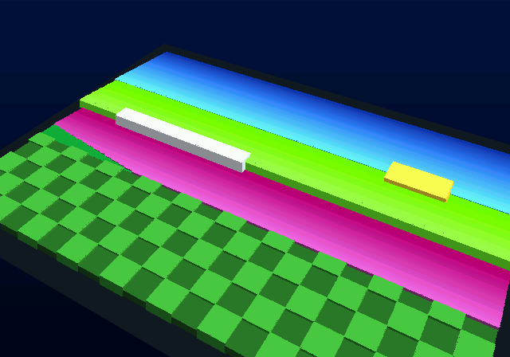

# Project Voxel

Cores **libretro** que reescrevem o quadro 2D de um emulador como uma cena 3D de blocos.
Cada pixel (ou grupo de pixels) do jogo vira um cubo com altura, cor, luz e sombra — o
jogo continua sendo o mesmo, mas passa a ter profundidade, câmera e iluminação.

O nome "Project Voxel" é o guarda-chuva do projeto. Existem hoje **duas implementações
independentes**, com arquiteturas opostas:

| | **Project Genesis 32X** | **Retro8 Voxel** |
|---|---|---|
| O que é | Um core **emulado**: PicoDrive compilado com o renderizador voxel dentro | Um **wrapper**: um core que carrega outro core em tempo de execução |
| Emula | Sega Mega Drive, Mega-CD, Master System, 32X, Game Gear, SG-1000 | PICO-8 (console fantasy) |
| Como o voxel entra | O patch **modifica o código-fonte** do emulador e intercepta `retro_run` | O wrapper **intercepta** o framebuffer que o core interno entrega |
| Acoplamento ao core | Total — o renderizador é parte do binário | Nenhum — qualquer core compatível serve, desde que o `.so` interno esteja na mesma pasta |
| Precisa do core original | Não | **Sim** — `retro8_libretro.so` (ou `retro8_libretro_android.so`) na mesma pasta |
| Tamanho do binário | ~2,3 MB (emulador completo + voxel) | ~56 KB (só o wrapper + renderizador) |
| Cenário | Cena 3D com blocos, chão e fundo | Cena 3D com **carcaça de videogame**, cujos botões afundam ao apertar |
| Formato de origem | RGB565 (o PicoDrive exige RGB565) | XRGB8888, com suporte a RGB565 e 0RGB1555 |
| Renderização | Painter's algorithm, sem z-buffer | **z-buffer** com rasterização de triângulos |
| Código-fonte | No [patch](patches/project-genesis-32x.patch) deste repositório | Publicado em [`xmyguel-x/retro8_voxel`](https://github.com/xmyguel-x/retro8_voxel) |

---

## Por que existem duas?

O renderizador voxel é, no fundo, um **pós-processador de framebuffer**: ele recebe a
imagem 2D que o emulador desenhou e devolve uma imagem 3D. Isso pode ser feito de duas
formas, e o projeto implementa as duas de propósito:

1. **Patch nativo** — você modifica o emulador, compila o renderizador junto com ele e
   intercepta o `video_cb`. Ganha acesso direto ao estado interno (geometria, opções,
   framebuffer) e um resultado mais integrado. Exige compilar o core.

2. **Wrapper genérico** — você escreve um `.so` que faz `dlopen()` do core original,
   repassa todas as chamadas da API libretro e troca a chamada `video_cb` por uma
   renderização voxel. Não precisa tocar no emulador, funciona com qualquer core, e
   adiciona recursos que o core original não tem — como a carcaça de console.

O [Retro8 Voxel](docs/RETRO8-VOXEL.md) é o segundo caminho. O
[Project Genesis 32X](docs/PROJECT-GENESIS-32X.md) é o primeiro, escolhido porque o
PicoDrive já roda Mega Drive, Mega-CD e 32X na mesma base.

---

## Como funciona o renderizador (resumo)

Ambos os implementos compartilham o mesmo pipeline de software, sem GPU e sem dependências:

```
frame 2D do emulador (RGB565)
        │
        ▼
 1. AMOSTRAGEM ── cada bloco de `step`×`step` pixels vira 1 célula
        │          (média de cor, saturação, contraste, paleta)
        ▼
 2. ALTURA ────── cada célula ganha uma altura (0..1) conforme o modo:
        │          relevo (brilho), diorama (degraus), cor→altura, plano (fixa)
        ▼
 3. CÂMERA ────── posição esférica (inclinação + azimute), FOV de 40°,
        │          zoom e suavização (lerp) entre quadros
        ▼
 4. CENA ──────── fundo em gradiente, chão opcional, luz direcional
        │
        ▼
 5. DESENHO ───── painter's algorithm: células de trás para frente.
        │          Cada célula visível desenha o topo + até 4 faces laterais
        ▼
 6. RASTERIZAÇÃO─ cada face é um quadrilátero recortado por half-planes
                   e preenchido em RGB565
        │
        ▼
  quadro 3D final
```

Os detalhes de cada etapa estão em **[docs/RENDERIZADOR-VOXEL.md](docs/RENDERIZADOR-VOXEL.md)**.

---

## Previews

Estas imagens foram geradas **pelo próprio renderizador do patch**, sem o RetroArch,
usando o harness em [`tests/voxel_test.c`](tests/voxel_test.c). A cena de teste é
sintética (320×224): céu em gradiente, sol, colinas, chão xadrez e uma faixa clara.

| Relevo + isométrica | Diorama + baixa | Neon + Noir | Cor para altura + frontal |
|---|---|---|---|
|  |  |  |  |

Para regenerar: `bash tests/run_previews.sh` (detalhes em
[`previews/README.md`](previews/README.md)).

---

## Validação

| Verificação | Resultado |
|---|---|
| Patch aplica na commit `1890c29` do PicoDrive | ✅ `git apply --check` limpo, 5 arquivos modificados + 2 novos |
| Compilação completa do core | ✅ `make -f Makefile.libretro` gera `project_genesis_32x_libretro.so` (2,2 MB) |
| Símbolos do renderizador exportados | ✅ `vox_enabled`, `vox_check_options`, `vox_output_size`, `vox_input`, `vox_render` |
| Identidade do core | ✅ `Project Genesis 32X` / `v1.0 (PicoDrive 2.05-1890c29)` |
| As 19 opções `project_genesis_*` presentes | ✅ |
| Renderização real de cena 3D | ✅ 4 modos/ câmeras renderizados, conferidos visualmente |
| Formato do framebuffer do PicoDrive | ✅ `RETRO_PIXEL_FORMAT_RGB565` na commit base |

O renderizador foi exercitado **fora** do RetroArch, com o hook `VOX_TEST` que o
próprio patch expõe — o que valida a geometria, a câmera, as paletas e a
rasterização de forma isolada.

---

## Estrutura do repositório

```
.
├── README.md                          ← você está aqui
├── LEIA-ME.txt                        ← instruções originais de uso
├── docs/
│   ├── RENDERIZADOR-VOXEL.md          ← como o renderizador 3D funciona por dentro
│   ├── PROJECT-GENESIS-32X.md         ← core 1: o patch no PicoDrive
│   ├── RETRO8-VOXEL.md                ← core 2: o wrapper do PICO-8
│   ├── OPCOES.md                     ← referência de todas as opções
│   └── INSTALACAO.md                  ← instalar no RetroArch e compilar
├── patches/
│   └── project-genesis-32x.patch      ← patch aplicado sobre o PicoDrive
├── scripts/
│   └── build_termux_32x.sh            ← compila o core no Termux (Android)
├── cores/
│   └── project_genesis_32x_libretro_android.info
├── tests/
│   ├── voxel_test.c                   ← harness que renderiza sem o RetroArch
│   └── run_previews.sh                ← gera os previews
└── previews/
    ├── README.md                      ← como e por que os previews são SVG
    ├── relevo_iso.svg
    ├── diorama_low.svg
    ├── neon_cinema.svg
    └── coraltura_front.svg
```

---

## Instalação rápida

- **PC (Linux/Windows)** — copie o `.so`/`.dll` para a pasta `cores` do RetroArch e o
  `.info` para a pasta `info`.
- **Android (Termux)** — rode `bash scripts/build_termux_32x.sh`; ele compila o core do
  zero e gera `project_genesis_32x_libretro_android.so`.
- **Retro8 Voxel** — coloque `retro8_voxel_libretro.so` **junto** do
  `retro8_libretro.so` original na mesma pasta de cores.

Os detalhes, as pastas exatas e as BIOS necessárias estão em
**[docs/INSTALACAO.md](docs/INSTALACAO.md)**.

---

## Desempenho

O renderizador roda inteiramente na CPU, em C99 puro, sem OpenGL e sem bibliotecas
externas (só `libm`). Os dois botões são:

- **Tamanho do voxel** (`step`): `1x` = 1 voxel por pixel (bem mais bonito, bem mais
  lento), `2x` e `4x` agrupam pixels e reduzem o número de células em 4× e 16×.
- **Resolução de saída**: renderiza a cena 3D em 320×224, 480×336, 640×448 ou 960×672.
  Resoluções menores são bem mais leves em celular.

Como o custo é proporcional ao número de células, um jogo em 320×224 com `step = 1`
são ~71.680 células por quadro — cada uma com até 5 faces. É por isso que o
`step` é a primeira coisa a mexer se o core travar.

---

## Estado atual

| Item | Situação |
|---|---|
| Core Linux x86_64 | ✅ Testado com ROM de teste (modos, câmera e paletas funcionando) |
| ROMs de 32X | ⚠️ Não testado |
| Mega-CD | ⚠️ Não testado |
| Build Android (Termux) | ⚠️ Não testado |
| DLL do Windows | ⚠️ Não testado |
| Retro8 Voxel — código-fonte | ✅ Publicado em [`xmyguel-x/retro8_voxel`](https://github.com/xmyguel-x/retro8_voxel) |
| Retro8 Voxel — binário com as 15 opções | ⚠️ Código-fonte não publicado; analisado por reverse engineering neste repositório |
| Retro8 Voxel — com o retro8 real em aparelho | ⚠️ Não testado |

---

## Créditos e licença

- **PicoDrive** — <https://github.com/libretro/picodrive> — base do Project Genesis 32X,
  sob licença estilo MAME. Autores: notaz, irixxxx e a comunidade.
- **Retro8** — <https://github.com/libretro/retro8> — implementação do PICO-8 em C++,
  a quem o wrapper do Retro8 Voxel delega a emulação.
- **Retro8 Voxel** — <https://github.com/xmyguel-x/retro8_voxel> — repositório com o
  código-fonte do wrapper e o workflow de build arm64.
- O renderizador voxel (`voxel.c` / `voxel.h` no patch, e o renderizador do wrapper) é
  código original deste projeto.

Este repositório documenta e distribui os componentes; as licenças originais dos
projetos de terceiros se aplicam integralmente aos seus arquivos correspondentes.
