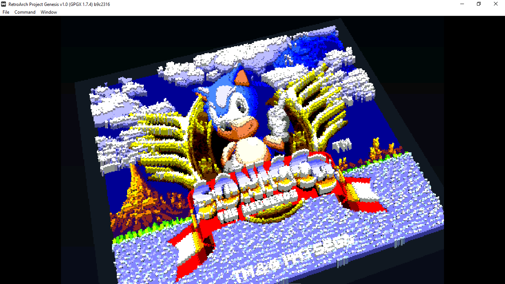
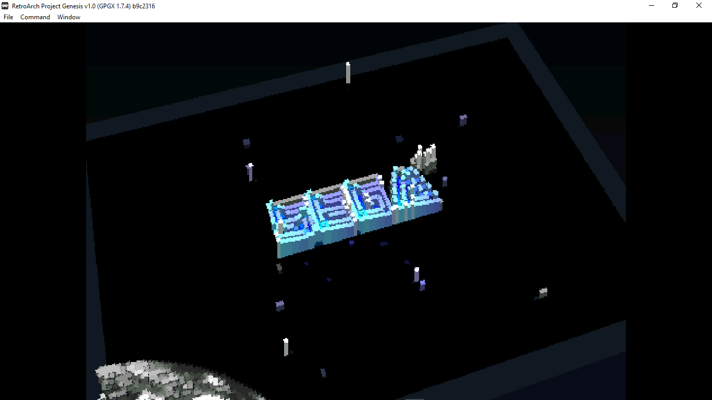
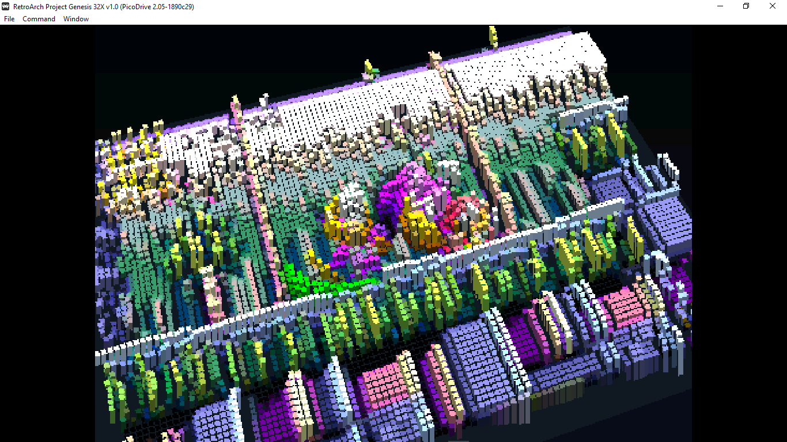

# Project Genesis

O core principal do Project Voxel: um emulador Sega com o **renderizador voxel 3D
compilado dentro**.

É **um core com 2 modos**, que se distinguem pela base de emulação usada:

| | **Modo GPGX** | **Modo PicoDrive (32X)** |
|---|---|---|
| Título no RetroArch | `Project Genesis v1.0 (GPGX 1.7.4) b9c2316` | `Project Genesis 32X v1.0 (PicoDrive 2.05-1890c29)` |
| Base | `libretro/genesis-plus-gx` @ `b9c2316` | `libretro/picodrive` @ `1890c29` |
| Emulador | **Genesis Plus GX** 1.7.4 | **PicoDrive** 2.05 |
| Sistemas | Mega Drive, Mega-CD, Master System, Game Gear, SG-1000 | os mesmos **+ 32X** |
| Formato de pixel | RGB565 **ou** XRGB1555 (negocia) | RGB565 (exigido) |
| Patch neste repositório | ⚠️ Não publicado | ✅ [`patches/project-genesis-32x.patch`](../patches/project-genesis-32x.patch) |
| Detalhe técnico | [PROJECT-GENESIS-GPGX.md](PROJECT-GENESIS-GPGX.md) | [PROJECT-GENESIS.md](PROJECT-GENESIS.md) |

Os dois modos compartilham **o mesmo renderizador** (`voxel.c`), **o mesmo namespace de
opções** (`project_genesis_*`) e **a mesma categoria** no menu do core
(*"Project Genesis (Voxel 3D)"*). O que muda é o emulador por baixo — e é por isso que
só o modo PicoDrive tem o "32X" no nome.

---

## Por que existem 2 modos?

O renderizador voxel nasceu no **modo GPGX** e foi reaproveitado no **modo PicoDrive**
para ganhar o 32X. A prova está nos próprios arquivos — e é uma prova que não depende
de suposição.

**1. As sobras textuais.** O patch do modo PicoDrive (que é o mesmo arquivo de código do
renderizador) ainda diz "Genesis Plus GX" em dois lugares que **não têm relação nenhuma**
com o PicoDrive:

```c
/* na descrição da opção principal, em libretro_core_options.h */
"Liga o renderizador voxel 3D. Desligado mostra a imagem 2D normal do Genesis Plus GX."
```

```c
/* no cabeçalho do renderizador, voxel.h */
"Recebe o framebuffer 16 bits do Genesis Plus GX e devolve um quadro 3D em voxels."
```

**2. A prova no código.** O renderizador tem dois caminhos de leitura de pixel:

```c
#ifdef FRONTEND_SUPPORTS_RGB565
   /* lê como RGB565 */
#else
   /* lê como 0RGB1555 */
#endif
```

Isso é **exatamente** a negociação de formato que o Genesis Plus GX faz no upstream:

```c
#ifdef FRONTEND_SUPPORTS_RGB565
      unsigned rgb565 = RETRO_PIXEL_FORMAT_RGB565;
      if (environ_cb(RETRO_ENVIRONMENT_SET_PIXEL_FORMAT, &rgb565))
         log_cb(RETRO_LOG_INFO, "Frontend supports RGB565 - will use that instead of XRGB1555.\n");
#endif
```

O PicoDrive, em contraste, **exige** RGB565 e aborta se o frontend recusar — ele nunca
usa o caminho XRGB1555. Ou seja: o renderizador foi escrito para um emulador que
negocia os dois formatos, e só o GPGX faz isso.

**3. O namespace de opções.** As chaves `project_genesis_*` e a categoria do core
options são as mesmas nos dois modos. Numa porta de GPGX e outra de PicoDrive, o nome
"Project Genesis" é o mesmo; o que muda é o sufixo que identifica o backend.

---

## O que os dois modos têm em comum

- **O mesmo renderizador** — `voxel.c` / `voxel.h`, software puro, C99, sem OpenGL.
- **As mesmas 19 opções** `project_genesis_*` (veja [OPCOES.md](OPCOES.md)).
- **A mesma interação** — analógico direito orbita a câmera, `R3` reseta.
- **A mesma cena** — grade de voxels com altura, luz direcional, chão e fundo em
  gradiente, até 960×672 de saída.

---

## Em execução

| Modo GPGX — cena densa (Sonic) | Modo GPGX — cena esparsa | Modo PicoDrive (32X) |
|---|---|---|
|  |  |  |

A diferença de densidade entre as duas capturas do modo GPGX **não é defeito** — é a
regra do renderizador: **pixel claro vira bloco alto, pixel escuro vira nada**. Um jogo
com muita área preta (fundo de tela) produz uma cena majoritariamente vazia; a mesma
regra, aplicada a um jogo com cenário denso, produz a cena cheia de voxels da primeira
imagem.

No modo GPGX dá para ver também a **tela do jogo como um plano inclinado** — a borda
escura ao redor do conteúdo é a borda do framebuffer de 320×224, que existe como uma
laje de voxels inclinada no espaço.

---

## Escolhendo um modo

| Você quer… | Use |
|---|---|
| Precisão de emulação do Master System / Mega Drive | Modo **GPGX** |
| Rodar jogos de **32X** | Modo **PicoDrive (32X)** |
| O core mais leve (~1 MB em vez de ~2,3 MB) | Modo **GPGX** |
| Suporte a outros sistemas do PicoDrive | Modo **PicoDrive (32X)** |

---

## Estado de teste

| Item | Situação |
|---|---|
| Modo GPGX | ✅ Confirmado rodando no RetroArch — `v1.0 (GPGX 1.7.4) b9c2316` |
| Modo PicoDrive (32X) | ✅ Confirmado rodando no RetroArch — `v1.0 (PicoDrive 2.05-1890c29)` |
| Patch do modo PicoDrive | ✅ Aplica e compila — verificado neste repositório |
| Patch do modo GPGX | ⚠️ Não publicado |
| ROMs de 32X / Mega-CD | ⚠️ Não testados |
| Build Android (Termux) | ⚠️ Não testado |
| DLL do Windows | ⚠️ Não testado |
